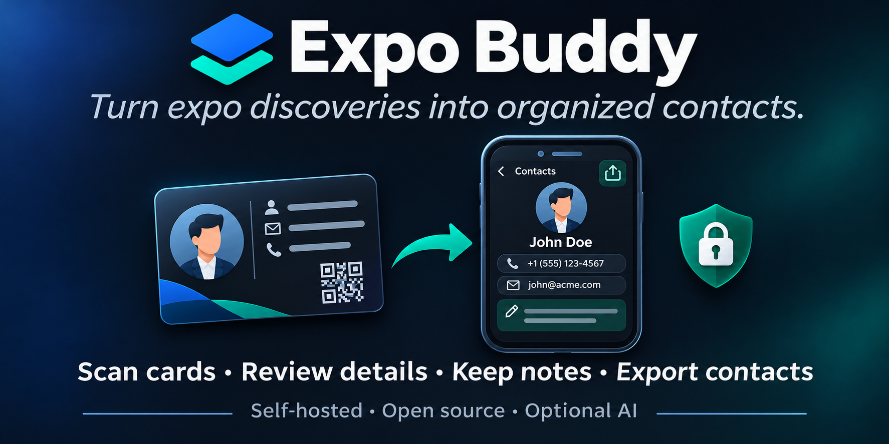

# Expo Buddy




A self-hosted home for the people, companies and ideas you collect at expos.
Scan visiting cards and brochures, check extracted details beside the originals,
keep private notes, and export the contacts you want to follow up with.

## What it does

- Photo/PDF capture, local CPU OCR and an offline phone capture queue.
- Companies and people, source evidence, manual corrections and field-by-field review.
- Keyword search with optional local semantic search.
- Excel, CSV, vCard and ZIP exports with review warnings.
- Optional Ollama, ChatGPT plan sign-in and OpenRouter processing.
- Backups, restore to a new database, and scoped MCP access for agents.

Personal notes remain local to your server. Optional cloud extraction sends printed
text and explicitly entered capture/reprocessing context. Optional image checks use
local Ollama. No provider account is needed to browse, edit or search your library.

## Install

Choose a method below, or follow the [manual installation guide](INSTALL.md#manual-install).

- **[AI-assisted install](#ai-assisted-install)** — copy the prompt into your coding agent.
- **[Easy install](#easy-install)** — run the commands in 6 steps.

**You need:** Linux x86-64, about 15 GB of free disk space, Git, curl and an internet
connection. The certificate commands below are for Ubuntu/Debian. Builds and model
downloads depend on your connection and computer. Python, Node and a GPU are not
required on the host. Windows and macOS are not supported yet.

### AI-assisted install

Use an AI coding agent that can run commands on your computer, such as Claude Code,
Cursor or Codex. Open it inside an empty folder, then copy and paste this prompt:

````text
Please install Expo Buddy on this computer from
https://github.com/Mayank13Jindal/Expo-Buddy and get it running.

Steps:
1. Check this is Linux x86-64 with at least 15 GB free disk space. If not, stop and tell me.
2. Check Docker Engine and "docker compose version" work without sudo. If Docker is
   missing, install it with the official script (get.docker.com) and add me to the
   docker group. Then tell me to log out and log back in, and wait for me.
3. Clone the repo and cd into it.
4. Ask me: "Should the app ask for a password when it opens? (Recommended.)"
   If yes, run ./scripts/docker.sh setup --password
   If no, run ./scripts/docker.sh setup --no-password
5. Run ./scripts/docker.sh models and then ./scripts/docker.sh models --kind embeddings.
   These are slow. Do not interrupt or re-run them while they are working.
6. Run docker compose up -d --build --wait, then check docker compose ps shows all
   services healthy. If something fails, read docker compose logs --tail=100 and fix it.
7. Trust the HTTPS certificate at
   .secrets/caddy-data/caddy/pki/authorities/local/root.crt in the system store.
8. Confirm https://localhost:8443 responds, and tell me to open it in my browser.

Rules:
- Never run ./scripts/docker.sh with sudo.
- Ask me before every sudo command.
- Never delete or overwrite .env, .secrets or .local. They hold my data and keys.
- Never disable TLS/certificate checks to make something work.
- Do not change GATEWAY_BIND or open the app to my network unless I ask.
- At the end, give me a short summary: what you did, the app address, and anything
  that failed.
````

The agent will ask before using `sudo`. Read each command before you say yes.

### Easy install

Open a terminal and run each step in order.

#### 1. Install Docker

Skip this step if Docker Engine and Compose v2 already work without `sudo`.

```sh
curl -fsSL https://get.docker.com | sh
sudo usermod -aG docker "$USER"
```

Log out and log back in before continuing, so Docker works without `sudo`.

#### 2. Get the code

```sh
git clone https://github.com/Mayank13Jindal/Expo-Buddy.git
cd Expo-Buddy
```

#### 3. Create settings and secrets

```sh
./scripts/docker.sh setup
```

Setup asks whether the app should ask for a password. Answer **y** (recommended):
you then create your password the first time you open the app. Answer **n** only if
the app stays on this computer; without a password, anyone who can reach it has full
access.

Setup creates `.env`, private secrets in `.secrets/` and storage under
`.local/data`. It preserves existing configuration. Never delete or share these
folders, and never run `./scripts/docker.sh` with `sudo`.

#### 4. Download the models

Downloads can take a while. Let each command finish before running the next.
The embeddings model is optional and enables semantic search.

```sh
./scripts/docker.sh models
./scripts/docker.sh models --kind embeddings
```

#### 5. Start the app

```sh
docker compose up -d --build --wait
docker compose ps
```

The first build can take several minutes. Check that every service is healthy.

#### 6. Trust HTTPS and open the app

On Ubuntu/Debian, trust this installation's public certificate:

```sh
sudo install -m 644 .secrets/caddy-data/caddy/pki/authorities/local/root.crt /usr/local/share/ca-certificates/expo-buddy.crt
sudo update-ca-certificates
```

Open **https://localhost:8443**. If the browser still warns about the certificate,
fully restart it. Chrome/Chromium may also need `./scripts/trust-local-ca.sh`
with `certutil` installed. Trust only the public `root.crt`; never share its
private key or disable certificate verification.

### Password and phone access

If you chose a password during setup, the app asks you to create it the first
time you open it. If you forget it, reset it on the server:

```sh
docker compose exec api python -m app.core.reset_password
```

To change your choice later, edit `PASSWORDLESS` in `.env` (`false` asks for a
password, `true` does not), then run `docker compose up -d --wait`. When switching
from password-free to a password, set the password with the command above first.

See [HTTPS and phone setup](docs/setup.md#https-and-phone-access). Provider sign-in
is separate, and cloud processing starts off.

### Everyday commands

```sh
docker compose ps                 # service health
docker compose logs --tail=100    # recent logs
docker compose stop              # stop; keep saved data
docker compose up -d --wait       # start again
```

[Setup and configuration](docs/setup.md) explains storage, providers and backups.
[.env.example](.env.example) documents configuration; setup generates the actual
values and secrets. [Recovery instructions](docs/backup-restore.md) explain how to
restore into a new database before cutover.

## How this was built

Expo Buddy is vibe coded. The code was written with AI coding agents,
[OpenAI Codex](https://openai.com/codex/) and
[Claude Code](https://claude.com/claude-code), directed and tested by
[Mayank13Jindal](https://github.com/Mayank13Jindal). It has automated tests
and was reviewed, but it is a young project: check it before you trust it
with important data.

## Project layout

```text
backend/       FastAPI, database migrations, processing and tests
frontend/      React/TypeScript web app and offline capture
scripts/       Setup, models, storage checks and restore utilities
deploy/        Caddy and Docker support
examples/      Fictional sample exports
docs/          Setup, providers, operation and recovery
```

See [CONTRIBUTING.md](CONTRIBUTING.md) for development and tests,
[SECURITY.md](SECURITY.md) for private reports, and [the GitHub guide](docs/github.md)
for publishing your copy. This project is licensed under [MIT](LICENSE).
Dependencies and model weights retain their own [licenses and notices](docs/NOTICES.md).

## Current limits

Expo Buddy is a personal, single-owner app. OCR and AI output need human review;
syntax validation does not prove a number belongs to a person. Phone storage is
not a backup: keep unsynced captures until the server confirms they are saved.
Real iPhone/Safari behavior, other CPU architectures and every provider/account
combination have not been verified. Windows/macOS Docker Desktop are not yet
supported by the host storage setup.
